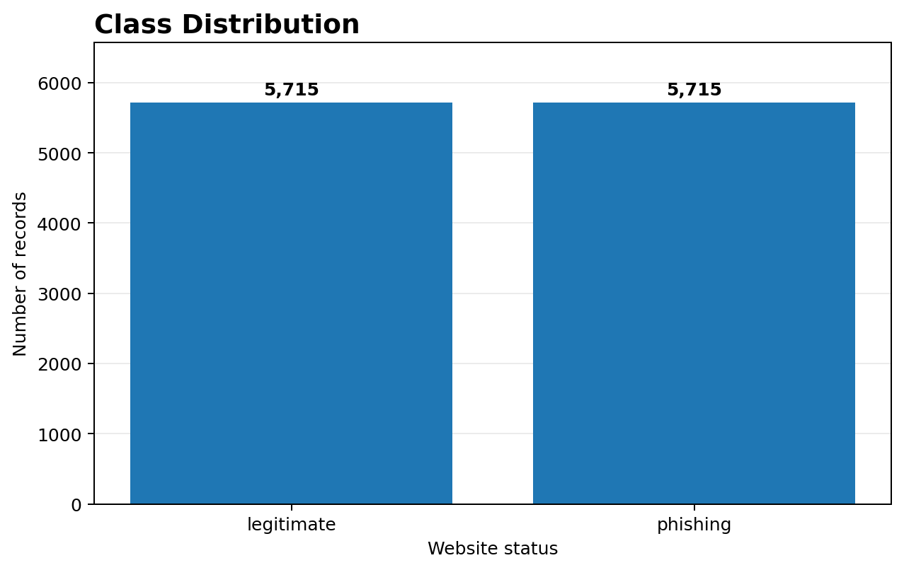
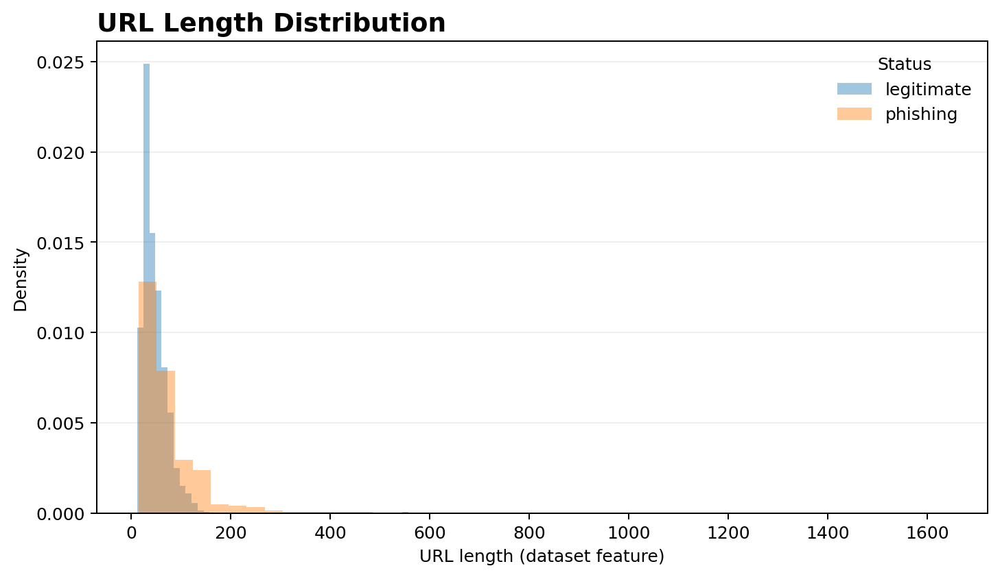
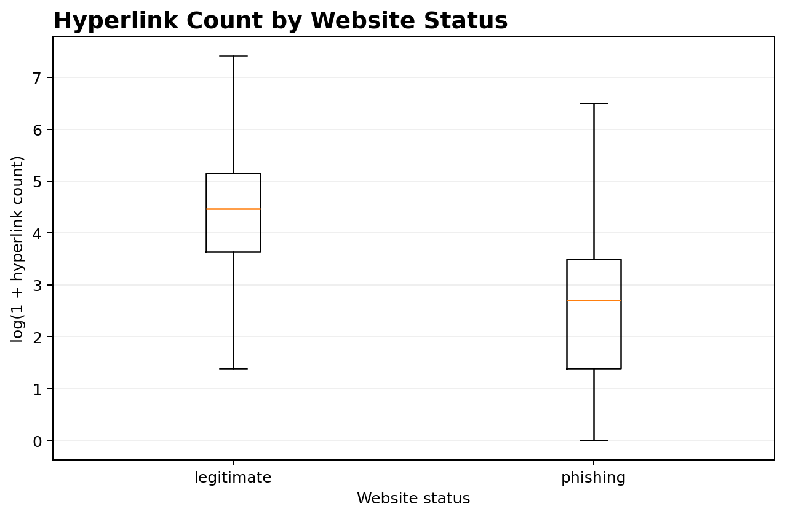
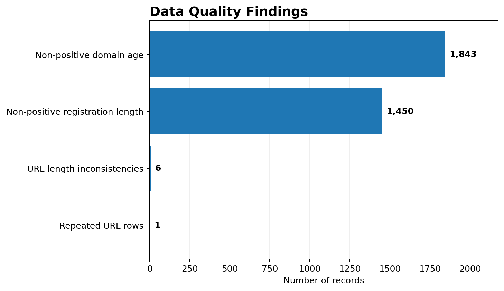

# Web Page Phishing Detection — Data Preprocessing & EDA


A reproducible R workflow for auditing, cleaning, preprocessing, and exploring the **Web Page Phishing Detection** benchmark dataset by Hannousse and Yahiouche.

The project focuses on data quality and exploratory data analysis before model development. It prepares reproducible training and testing datasets, but **does not train or deploy a phishing-classification model**.

---

## Contents

- [Project overview](#project-overview)
- [Dataset](#dataset)
- [Data quality audit](#data-quality-audit)
- [EDA preview](#eda-preview)
- [Preprocessing workflow](#preprocessing-workflow)
- [Repository structure](#repository-structure)
- [Requirements](#requirements)
- [How to run](#how-to-run)
- [Generated outputs](#generated-outputs)
- [Methodological decisions and limitations](#methodological-decisions-and-limitations)
- [Dataset citation and licence](#dataset-citation-and-licence)

## Project overview

Phishing websites imitate legitimate websites to persuade visitors to disclose sensitive information. This project examines a benchmark dataset containing URL, webpage-content, and external-service features associated with phishing and legitimate websites.

### Objectives

1. Inspect the source dataset and report data-quality issues.
2. Explore the distribution of selected features by website status.
3. Handle invalid or sentinel values in duration-related features.
4. Create a reproducible, stratified training/testing split.
5. Fit imputation, outlier-capping, and scaling parameters using training data only.
6. Remove predictors with zero variance in the training partition.
7. Export clean datasets for subsequent modelling.

## Dataset

| Item | Description |
|---|---|
| Dataset | Web page phishing detection |
| Original authors | Abdelhakim Hannousse and Salima Yahiouche |
| Version | 3 |
| Publication date | 25 June 2021 |
| Records | 11,430 |
| Numeric extracted features | 87 |
| URL identifier | 1 |
| Target variable | `status` |
| Class distribution | 5,715 phishing / 5,715 legitimate |
| Source | [Mendeley Data](https://data.mendeley.com/datasets/c2gw7fy2j4/3) |
| DOI | [10.17632/c2gw7fy2j4.3](https://doi.org/10.17632/c2gw7fy2j4.3) |

The dataset authors describe the 87 features as:

- 56 URL structure and syntax features;
- 24 webpage-content features;
- 7 features obtained from external services.

The benchmark was constructed using data collected in May 2020. It is a historical research dataset, not a live feed of current phishing websites.

## Data quality audit

The included raw CSV was inspected directly. The following findings are reproducible from the supplied file.

| Check | Result |
|---|---:|
| Rows | 11,430 |
| Columns | 89 |
| Numeric predictor features | 87 |
| Actual missing cells | 0 |
| Exact duplicate rows | 0 |
| Unique URL identifiers | 11,429 |
| Repeated URL groups | 1 |
| Additional rows from repeated URLs | 1 |
| `domain_age` values less than or equal to zero | 1,843 |
| `domain_registration_length` values less than or equal to zero | 1,450 |
| `length_url` values above 2,000 | 0 |
| `length_url` values not equal to the URL character count | 6 |
| Zero-variance numeric features | 6 |
| Phishing / legitimate records | 5,715 / 5,715 |

### Zero-variance features identified

The raw dataset contains six numeric features with only one distinct value:

- `nb_or`
- `ratio_nullHyperlinks`
- `ratio_intRedirection`
- `ratio_intErrors`
- `submit_email`
- `sfh`

The preprocessing script checks zero variance on the training partition and removes any such predictors from both exported datasets. It does not remove near-constant features automatically.

### Repeated URL

One exact URL identifier occurs twice with different extracted feature values. Both rows have the same `phishing` label. The records are retained, but the split assigns all rows with the same exact URL identifier to the same partition.

### URL length inconsistencies

Six records have a `length_url` value that differs from the character count of the URL string. The source feature values are preserved and flagged in the audit; they are not silently overwritten.

The audit snapshots are available in [`outputs/tables/`](outputs/tables/).

## EDA preview

The following preview figures are included so the repository is immediately understandable on GitHub. Running the R script regenerates the figures.

### Class distribution



### URL length distribution



### Hyperlinks by website status



### Data quality findings



## Preprocessing workflow

The R script performs the following steps in order:

1. **Load and validate** the source CSV and required columns.
2. **Audit data quality**, including missing values, exact duplicates, repeated URLs, invalid duration values, URL-length inconsistencies, and zero-variance features.
3. **Create EDA outputs** from the original data.
4. **Remove exact duplicate rows**, if any are present.
5. **Apply the URL-length rule** before scaling (`length_url` greater than 2,000 is excluded). No rows are removed by this rule in the supplied dataset.
6. **Create a stratified 70:30 split** over unique exact URL identifiers, using random seed `42`.
7. **Convert non-positive duration values** in `domain_age` and `domain_registration_length` to missing values.
8. **Impute numeric missing values** using medians calculated from the training partition only.
9. **Cap selected outliers** using IQR limits calculated from the training partition only.
10. **Remove zero-variance predictors** identified in the training partition.
11. **Min-max scale selected numeric features** using minimum and maximum values calculated from the training partition only.
12. **Validate and export** the training and testing datasets without the raw URL identifier.

No downsampling is applied: the supplied benchmark is already balanced, and the split is stratified by class.

## Repository structure

```text
web-page-phishing-preprocessing-r/
├── .github/
│   └── workflows/
│       └── r-preprocessing.yml
├── data/
│   ├── raw/
│   │   ├── dataset_phishing.csv
│   │   └── README.md
│   └── processed/
│       └── .gitkeep
├── docs/
│   ├── DATASET_ATTRIBUTION.md
│   ├── GITHUB_METADATA.md
│   └── REPRODUCIBILITY_NOTES.md
├── outputs/
│   ├── figures/
│   │   ├── class_distribution.png
│   │   ├── url_length_distribution.png
│   │   ├── hyperlinks_by_status.png
│   │   └── data_quality_issues.png
│   ├── tables/
│   │   ├── data_quality_audit.csv
│   │   ├── descriptive_statistics_by_status.csv
│   │   └── feature_quality_audit.csv
│   └── README.md
├── R/
│   └── 01_preprocess_and_eda.R
├── .gitattributes
├── .gitignore
├── README.md
└── web-page-phishing-preprocessing-r.Rproj
```

## Requirements

- R version 4.1 or later
- RStudio (recommended)
- R package: `ggplot2`

Install the required package once:

```r
install.packages("ggplot2")
```

All data import, validation, preprocessing, and CSV export operations use base R.

## How to run

1. Download or clone this repository.
2. Open `web-page-phishing-preprocessing-r.Rproj` in RStudio.
3. Install `ggplot2` if it is not already installed.
4. Run the following command in the RStudio Console:

```r
source("R/01_preprocess_and_eda.R")
```

The script identifies the project root when sourced from RStudio or run with `Rscript`. It reads the included raw CSV using a relative project path.

The script does not visit or connect to any URL in the dataset.

## Automated validation

A GitHub Actions workflow is included at `.github/workflows/r-preprocessing.yml`. It installs R and
`ggplot2`, then runs the preprocessing script on each push and pull request. This provides an
automatic check that the workflow completes in a clean GitHub-hosted environment.

## Generated outputs

After a successful run, the script creates or refreshes:

### Processed datasets

- `data/processed/train_data.csv`
- `data/processed/test_data.csv`

The raw `url` identifier is excluded from these files. The categorical `status` target is retained.

The processed CSV files are ignored by Git because they can be regenerated from the included source dataset and script.

### Figures

- `outputs/figures/class_distribution.png`
- `outputs/figures/url_length_distribution.png`
- `outputs/figures/hyperlinks_by_status.png`
- `outputs/figures/data_quality_issues.png`

### Tables and run details

- `outputs/tables/data_quality_audit.csv`
- `outputs/tables/feature_quality_audit.csv`
- `outputs/tables/descriptive_statistics_by_status.csv`
- `outputs/tables/imputation_parameters.csv`
- `outputs/tables/outlier_bounds.csv`
- `outputs/tables/scaling_parameters.csv`
- `outputs/tables/removed_zero_variance_features.csv`
- `outputs/tables/run_summary.txt`

## Methodological decisions and limitations

- **Historical benchmark:** the dataset was constructed in May 2020. Its features and external-service information may not represent current websites or phishing campaigns.
- **Sentinel-value assumption:** non-positive `domain_age` and `domain_registration_length` values are treated as invalid or unavailable duration measurements, converted to missing values, and imputed. This is an explicit preprocessing decision, not a claim that the dataset authors assigned the same meaning to every such value.
- **Exact URL grouping:** repeated instances of the same exact URL are kept in one partition. This is not a registrable-domain or hostname-level split; different URLs from the same host may still appear in both partitions.
- **URL length inconsistencies:** the six flagged source values are retained as supplied. The workflow does not infer or overwrite the original feature values.
- **Training-only fitting:** imputation medians, IQR bounds, and min-max parameters are fitted on training data and then applied to testing data. Test values may fall outside the training min-max interval; they are not clipped to 0–1 after scaling.
- **Feature selection scope:** only zero-variance predictors are removed automatically. Near-constant features and correlated predictors are retained for later analysis.
- **No model training:** this repository prepares data and performs EDA. It does not report classifier accuracy, precision, recall, F1-score, or live detection performance.

## Dataset citation and licence

Hannousse, A., & Yahiouche, S. (2021). *Web page phishing detection* (Version 3). Mendeley Data.  
https://doi.org/10.17632/c2gw7fy2j4.3

The dataset is distributed under the [Creative Commons Attribution 4.0 International (CC BY 4.0)](https://creativecommons.org/licenses/by/4.0/) licence. The dataset attribution is documented in [`docs/DATASET_ATTRIBUTION.md`](docs/DATASET_ATTRIBUTION.md).

The dataset licence does not automatically apply to the original R code or other project materials. No separate source-code licence is assigned in this repository.
